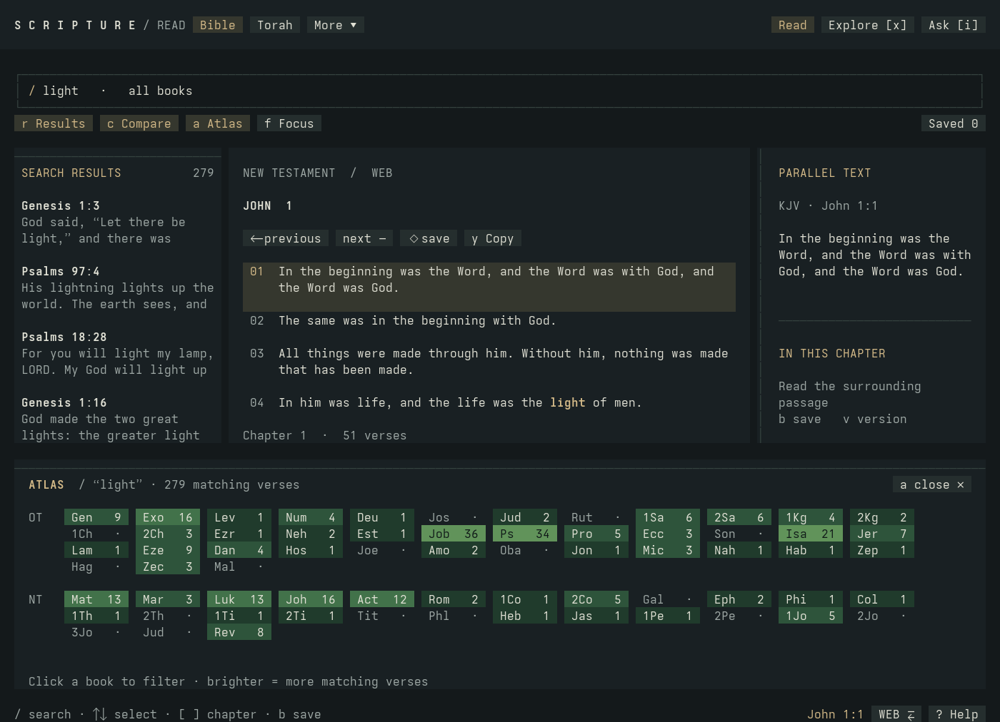
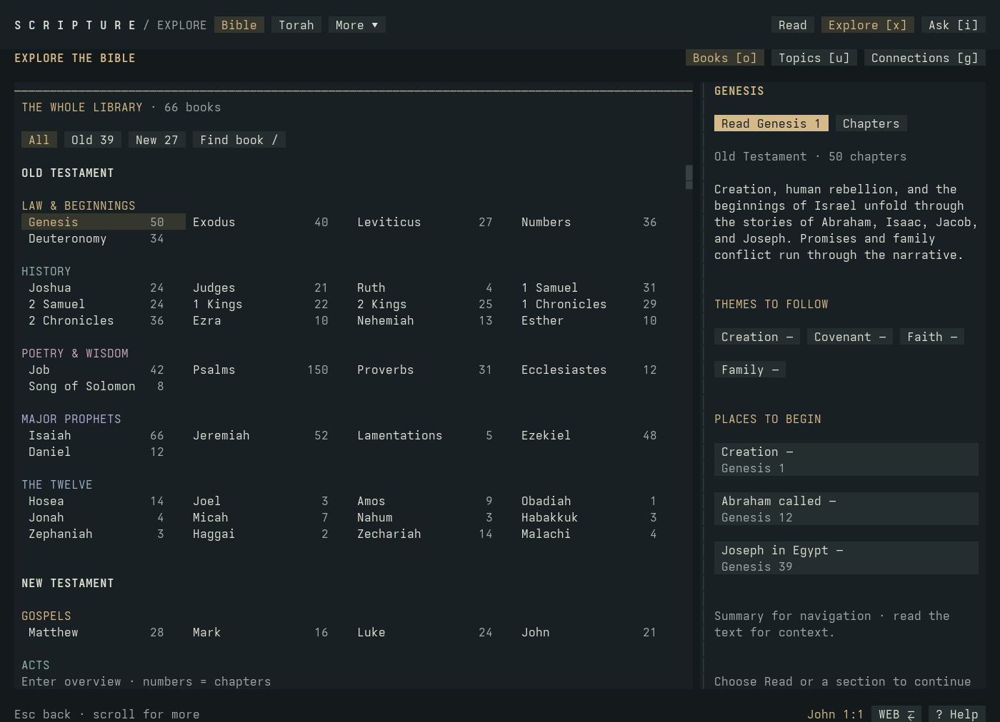
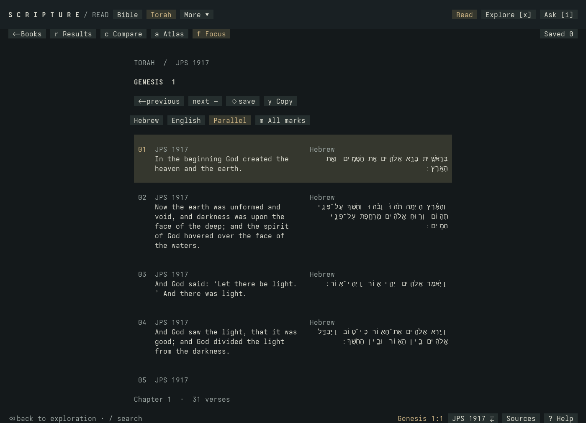
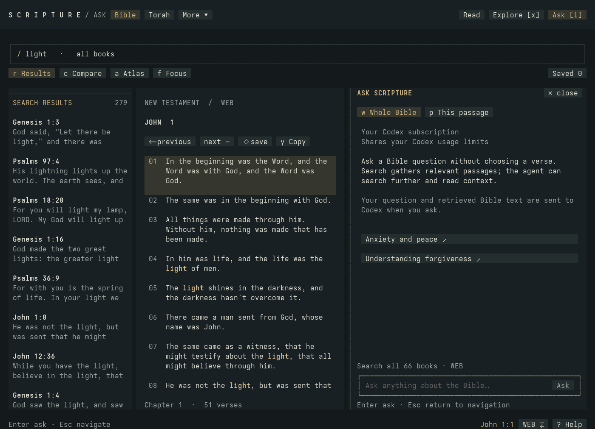

# Scripture Terminal

[](https://github.com/propater321/scripture-terminal/actions/workflows/ci.yml)
[](LICENSE)

**Read, explore, and ask questions about the Bible and Jewish texts in your terminal.**

Scripture Terminal combines a reader, visual book explorer, passage comparison, topic search and optional AI study companion in one keyboard-and-mouse workspace. It runs as a native terminal app, built with Bun, React, OpenTUI and SQLite. Reading and keyword search need no account or GPU.



Toggle search results, comparison and Atlas independently, or press **f** for focused reading. Atlas shows where a word appears across books; brighter cells mean more matching verses.

Read passages, browse summaries and native sections, follow connections, compare available editions, and save bookmarks. **Ask** can investigate a question across the selected library through your Codex login and return clickable citations. Reading and prepared search work offline; Ask is optional.

## Quick start

This initial source release is validated on **Linux x64**. Use **Bun 1.4.4**, **Python 3.12+**, a UTF-8 terminal of at least **60 columns × 18 rows**, and **FriBidi** for Hebrew/Aramaic display. On Debian/Ubuntu the library package is `libfribidi0`; on Arch it is `fribidi`. Other operating systems have not been validated.

```sh
git clone https://github.com/propater321/scripture-terminal.git
cd scripture-terminal
bun install --frozen-lockfile
bun run import
./bin/scripture
```

If you downloaded a source archive, extract it and run the last three commands from its directory.

The initial import downloads the pinned KJV and WEB editions. A Codex account, Python search environment, and GPU are **not required** for reading or keyword search. Check local prerequisites and installed text with:

```sh
bun run doctor
./bin/scripture --help
./bin/scripture --version
```

Optionally put the launcher on your PATH:

```sh
mkdir -p "$HOME/.local/bin"
ln -s "$(pwd)/bin/scripture" "$HOME/.local/bin/scripture"
```

Add `$HOME/.local/bin` to your PATH if needed. The symlink points at this checkout; keep the directory in place. The app stores downloaded data and bookmarks under its own `data/` directory. **Back up `data/study.sqlite` before deleting or replacing a checkout.** Updates should preserve that directory and use the new lockfile.

## A look around

| Explore books and themes | Read Torah in Hebrew and English |
| --- | --- |
|  |  |

**Explore** starts with books and summaries, then leads into sections, Topics and Connections. The Torah reader offers Hebrew, English and parallel views, with controls for Hebrew marks. Click an image to see it at full size.

<details>
<summary><strong>See the optional Ask panel</strong></summary>



Ask a question such as “What does the Bible say about forgiveness?” without choosing a verse, or ask about the passage you are reading. The screenshot shows the ready state; no generated answer or account information is included.

</details>

These images are captures of the actual OpenTUI renderer at 140 × 44 cells, rasterized for the README. Terminal fonts may look different. [Capture method and text attribution](docs/images/README.md).

## How it works

1. **Import once.** Importers download named editions, verify pinned checksums, and build local SQLite databases with canonical references and full-text indexes. Texts and models are separate from the source release.
2. **Read and explore locally.** The terminal UI reads from those databases. Book summaries, chapter navigation, comparison, bookmarks and installed connections do not need an LLM.
3. **Find words or ideas.** Keyword search uses SQLite FTS5. Optional meaning search embeds your query locally, compares it with indexed passages, combines keyword and semantic rankings, and can rerank the candidates. Missing models or stale indexes produce an explicit keyword fallback.
4. **Ask with evidence.** Whole-library questions start with local retrieval. Codex can request more searches, read surrounding passages and follow installed connections within that library. The app validates returned citation IDs against retrieved text and lets you open the sources. Your question and retrieved excerpts are sent to OpenAI only when you submit Ask.

The whole library is searchable; it is not all placed into one model prompt. Retrieval has evidence and tool-call limits, so answers can miss relevant material. [Read the architecture and data flow](docs/how-it-works.md).

## Choose a library

Use **More ▾** in the header or **F5**. Each opened library retains its reading position during the session. Bible and Torah also have header shortcuts; F4 toggles those two.

| Library | Launch | Selected coverage |
| --- | --- | --- |
| Bible | `scripture` | 66 books, KJV / WEB |
| Torah | `scripture torah` | Five books, Hebrew / JPS 1917 |
| Babylonian Talmud | `scripture bavli` | 37 tractates, original / available English |
| Jerusalem Talmud | `scripture yerushalmi` | 39 tractates, original / available English |
| Mishnah | `scripture mishnah` | 63 tractates, original / available English |
| Midrash | `scripture midrash` | 15 collections, language coverage varies |
| Zohar | `scripture zohar` | Available Soncino English, 46 portions; English-only |
| Shulchan Aruch | `scripture shulchan` | Four main parts and two appendices; English is partial |

Install optional text libraries:

```sh
bun run import:torah
bun run import:jewish --library mishnah   # one added library
bun run import:jewish                    # all six added libraries
```

Midrash includes the ten Rabbah collections (Bereshit, Shemot, Vayikra, Bamidbar, Devarim, Shir HaShirim, Ruth, Esther, Kohelet, Eikhah), Midrash Tanchuma, Mekhilta DeRabbi Yishmael, Sifra, Sifrei Bamidbar, and Sifrei Devarim. Named subsections appear separately in Explore. This is a defined selection, not every midrashic work.

The app shows missing languages and segments explicitly. It does not generate substitute translations. Original Hebrew/Aramaic and English editions can differ in coverage and contain explanatory material. **Sources** identifies the current work's editions, attribution, licenses and coverage. **Notes [n]** shows extracted edition footnotes separately from the main text.

**Licensing matters:** the code is MIT; imported texts are not relicensed. William Davidson Talmud and the selected original Beeri Mekhilta carry **CC-BY-NC** terms. The GitHub source archive excludes downloaded texts, models and generated excerpts. Read [NOTICE.md](NOTICE.md) before redistribution or commercial use. All source URLs and checksums are in `sources/`.

## Reading and exploring

The header has **Read**, **Explore**, and **Ask**. Explore contains a visual library, summaries, a section picker, local Topics search, and Connections. Hebrew uses Unicode bidirectional layout; copy with **y** to preserve logical text order and marks. Parallel reading stacks or aligns columns to fit the available space.

References follow each edition, for example:

- `John 3:16`, `Shemot 3:14`, or `בראשית 1:1`
- `Berakhot 2a:1` or `Jerusalem Talmud Berakhot 1:1:1`
- `Mishnah Berakhot 1:1` or `Bereshit Rabbah 1:1`
- `Zohar, Introduction 1:1`
- `Shulchan Arukh, Orach Chayim 1:1`

Zohar references use this export's named sections, not older volume/folio numbering. Torah verse boundaries follow its Sefaria editions and can differ from Bible translations. Connections and questions stay within the selected library.

| Key | Action |
| --- | --- |
| F5 | Choose a library |
| `/` | Search words or jump to a reference while reading |
| Ctrl+F | Global reference/word search from Explore |
| `x` | Explore; `o` library, `u` topics, `g` connections |
| `i` | Ask; choose whole library or current passage |
| `r` / `c` / `a` | Results / comparison / Atlas |
| `f` | Focus reading; restore the previous layout |
| `1` / `2` / `3` | Study / focused reading / study with Atlas |
| `[` / `]` | Previous / next native section |
| arrows or `j` / `k` | Select a passage or result |
| PgUp / PgDn | Scroll the focused pane |
| `v` | Switch edition |
| `d` / `m` | Parallel reading / Hebrew mark display |
| `b` / `s` | Save passage / saved passages |
| `y` | Copy selected text |
| Backspace | Return to the exploration you opened a passage from |
| `?` / `q` | Help / quit |

Clickable controls highlight on hover. `scripture explore` opens Explore directly; `scripture reader`, `scripture study`, and `scripture atlas` open the original focused layouts.

## Optional search and connections

Keyword search uses SQLite FTS5. Meaning search additionally needs [uv](https://docs.astral.sh/uv/), the pinned Python runtime packages, and downloaded models:

```sh
bun run setup:search       # creates .venv-search with Python 3.12
bun run index:semantic     # Bible index
bun run setup:torah-search # shared multilingual models for the other libraries
bun run index:torah        # after importing Torah
bun run index:jewish mishnah
# Or index all installed added libraries:
# bun run index:jewish bavli yerushalmi mishnah midrash zohar shulchan
```

No GPU is needed. CPU indexing can take time; all libraries, sources and models used in development occupy roughly 4 GB, with extra space needed while building indexes. Missing or stale indexes produce an explicit keyword fallback. Refine optionally reranks candidate passages locally. Questions in English or Hebrew can retrieve the other language; results identify the edition actually available. Long rabbinic segments use overlapping token windows and retain their complete source text for reading.

Install optional reference datasets after their texts:

```sh
bun run import:links
bun run import:torah-links
bun run import:jewish-links # requires all six added text libraries
```

Source checksums stop changed downloads instead of silently replacing reviewed data. If an upstream snapshot changes, the previous installed database is preserved; report the mismatch for a reviewed manifest update. Rebuild semantic indexes and connections after changing a corpus. The source release does not guarantee continued availability of upstream snapshots.

Connections are editorial aids. Zohar has no cross-references reliably mapped to this export; its **Context** toggle and Topics still work. Cross-library links and whole-library comparisons in one question are not implemented.

## Ask through Codex

Install the [Codex CLI](https://developers.openai.com/codex/cli), then run `codex login` and sign in with ChatGPT. Ask uses that managed login through app-server; API-key accounts are rejected. It does not read or copy login tokens or change your Codex configuration. Model access and usage limits depend on your account. No inference happens until you submit a question.

Whole-library Ask can search, read context and follow available references. Answers resolve citations to the text actually retrieved. Retrieved excerpts and your question are sent to OpenAI. Citation validation does not guarantee the interpretation is correct or the search exhaustive. Keep source evidence in view.

The integration is tested with **Codex CLI 0.164.0** and uses [experimental dynamic tools](https://learn.chatgpt.com/docs/app-server#dynamic-tool-calls-experimental). Compatibility can change with CLI releases. The app uses ephemeral threads, temporary working directories and restricted tools; [SECURITY.md](SECURITY.md) describes the limits and data flow. Scripture is an independent project, not an OpenAI or Sefaria product.

## Development and release checks

```sh
bun run check:release        # types, source-only tests, import tests, artifact checks
bun test                    # runs all available tests; missing corpora are reported/skipped
bun run test:integration     # requires Bible + its connection database
bun run test:integration --all
bun run doctor
```

Before releasing changes to search or imported text, run the relevant data and native terminal checks:

```sh
python3 scripts/check-jewish-data.py
bun scripts/check-explore.ts
bun scripts/check-torah.ts
bun scripts/check-jewish-terminal.ts
bun scripts/check-torah-search.ts
bun scripts/check-jewish-search.ts
bun scripts/evaluate-search.ts
```

Live subscription checks are **separate**: `bun run check:research` or `bun scripts/check-jewish-research.ts`. They submit a question using your account and write generated evidence under ignored `previews/`; CI does not run them. Never publish those files with a release.

`bun run preview` is an optional localhost development preview of the terminal, not the production app or a hosted service. Do not expose it to a network. Terminal captures and PNG rendering scripts are also development-only.

```sh
bun run bundle:source
```

This creates `dist/scripture-0.1.0-source.tar.gz` and its SHA-256 file, excluding runtime data and generated outputs. CI checks the source, dependency audits and a fresh Bible installation. The complete optional-library suite is run locally before a release. See [CONTRIBUTING.md](CONTRIBUTING.md), [CHANGELOG.md](CHANGELOG.md), the [release checklist](docs/release-checklist.md), and the [0.1.0 review](docs/release-review.md).

The pinned Bible data is an upstream snapshot, not an independently certified critical edition. Morphology, geographic maps, note editing, additional languages and further text collections remain future work.
