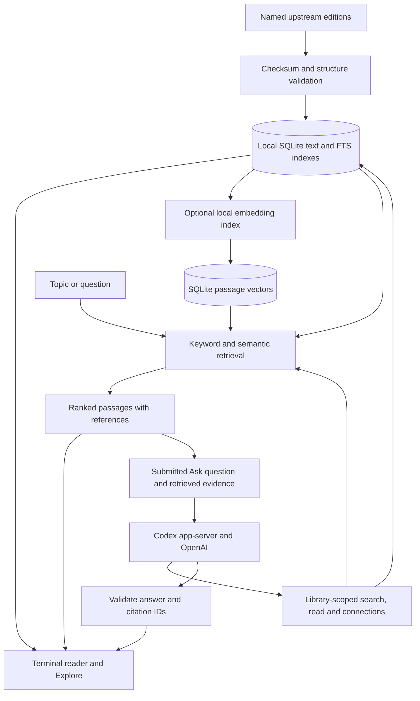

# How Scripture Terminal works

Scripture Terminal has three parts: a local text library, a terminal interface, and an optional Codex study companion. The first two work without an account. Semantic search uses local embedding and reranking models; it does not ask a generative model to invent search results.

## Texts, references and storage

Import manifests in `sources/` name each edition, its source URL, attribution, license and expected checksum. Importers validate downloaded and cached sources before replacing a corpus database. HTML text is normalized for terminal display; Jewish text imports also preserve original HTML and separate edition footnotes. Missing translations remain visible gaps.

The installed files live under `data/`: corpus SQLite databases, optional connection databases, semantic indexes, model caches and the separate `study.sqlite` bookmark database. They are ignored by Git and excluded from release archives. Source installation does not download every library automatically.

The shared reader talks to a store interface. Bible, Torah and the added Jewish libraries supply their own books, editions, references, summaries and coverage. This keeps Read, Explore, Topics and Ask consistent while preserving native addresses such as chapter/verse, daf/amud, mishnah and siman/seif. Each question stays within its selected library.

## Search pipeline

**Keyword search** runs SQLite FTS5 queries over installed text, ranking matches with BM25. Direct references resolve against the selected edition's numbering instead of guessing from similar words.

**Semantic search** is optional. Bible and Torah indexes group nearby verses into overlapping passages; longer rabbinic segments use overlapping token windows while retaining full source text for reading. FastEmbed/ONNX runs on the CPU. Bible embeddings use BGE-small-en-v1.5; Torah and the other Jewish libraries use multilingual E5-small so Hebrew and English queries can retrieve across available languages.

Vectors are stored as normalized float arrays in SQLite and loaded into a NumPy matrix by a local Python worker. Query vectors are compared by dot product, equivalent to cosine similarity for normalized vectors. This release uses exact local vector comparison. The terminal process communicates with the worker using JSON lines.

Keyword and semantic candidate lists are combined with reciprocal rank fusion. Optional **Refine** scores the candidates with a local cross-encoder. A corpus fingerprint detects stale indexes; unavailable or incompatible semantic resources fall back to keyword results with a notice. Similarity and reranking scores measure retrieval relevance, not truth or confidence in a religious interpretation.

## What happens when you ask

**This passage** supplies the selected text, chapter context, an available parallel edition and relevant supplied passages. **Whole library** first searches the installed collection, then gives Codex three bounded tools: search, read a reference and list connections. Connections must be read before their text can be cited.

The current whole-library implementation permits up to eight tool calls and caps the collected evidence. Retrieved passages receive source IDs such as `S1`; the answer schema requires citations and an insufficient-evidence flag. Unknown IDs and invalid citation ranges are rejected. Clicking a citation navigates back to the actual edition and passage. These checks establish source identity, not whether an interpretation is persuasive or complete.

The app starts the installed `codex app-server` over standard input/output. It checks for a managed ChatGPT login, lists available models, prefers `gpt-6.1-sol` when available, and otherwise uses the account's default or first available model. It rejects API-key accounts and removes API-key environment variables from its child process. It does not read or copy authentication tokens.

Ask threads are ephemeral and use a temporary working directory, read-only permissions and restricted tools. Shell, browsing, plugins and inherited MCP tools are disabled. Questions and retrieved excerpts go to OpenAI; model access and usage limits belong to the user's account. The integration was tested with Codex CLI 0.164.0 and uses the [experimental dynamic-tool interface](https://learn.chatgpt.com/docs/app-server#dynamic-tool-calls-experimental). See [SECURITY.md](../SECURITY.md) for the boundary and data flow.

## Where to look in the code

| Area | Main files |
| --- | --- |
| Startup and interface | `src/main.tsx`, `src/app.tsx`, `src/controls.tsx` |
| Reading and collection adapters | `src/store.ts`, `src/torah-store.ts`, `src/torah-adapter.ts`, `src/jewish-store.ts` |
| Visual exploration | `src/explore.tsx`, `src/library-view.tsx`, `src/topics.tsx`, `src/connections.tsx` |
| Retrieval | `src/search.ts`, `scripts/search-model.py`, `scripts/index-jewish.py`, `scripts/search_chunks.py` |
| Evidence and answers | `src/research.ts`, `src/study.ts`, `src/codex.ts` |
| Import and provenance | `scripts/import*`, `sources/` |

The normal interface is a native terminal application. The localhost browser preview is a development adapter that relays terminal input/output through a PTY; it is not required to use the app.
